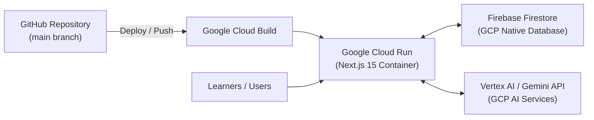

# Google Cloud Platform (GCP) & Firebase Setup Guide

This guide provides end-to-end instructions for deploying the **AI-Powered Learning Platform** using your **Google Cloud credits**, configuring **Firebase Firestore**, and maintaining CI/CD with **GitHub**.

---

## Architecture Overview



---

## Phase 1: Activate GCP Credits & Initialize Project

1. **Access Google Cloud Console**:
   - Go to [Google Cloud Console](https://console.cloud.google.com/).
   - Ensure your account has the Google Cloud promotional/educational credits applied under **Billing** -> **Credits**.
2. **Create a New GCP Project**:
   - Click the project dropdown at the top left -> **New Project**.
   - **Project Name**: `skillbridge-learning-platform` (or your preferred name).
   - Link your **Billing Account** (which holds your GCP credits).
   - Note down your **Project ID** (e.g., `skillbridge-learning-12345`).
3. **Enable Required Google Cloud APIs**:
   - In the GCP Search Bar, search and enable:
     - **Cloud Run Admin API**
     - **Cloud Build API**
     - **Artifact Registry API**
     - **Vertex AI API** (if using Vertex Gemini models)

---

## Phase 2: Configure Firebase with the Same GCP Project

Because Firebase is built on Google Cloud, your Firebase project and GCP project share the same project ID and billing credits.

1. **Open Firebase Console**:
   - Visit [Firebase Console](https://console.firebase.google.com/).
2. **Add Project**:
   - Click **Add project**.
   - Select your existing Google Cloud project from the dropdown.
   - Click **Continue** (Firebase tools will be added without creating a separate billing account).
3. **Enable Cloud Firestore**:
   - In the left sidebar, navigate to **Build** -> **Firestore Database**.
   - Click **Create database**.
   - **Database mode**: Select **Native mode**.
   - **Location**: Choose a region close to you (e.g., `asia-south1` or `us-central1`).
   - **Security Rules**: Select **Start in test mode** for initial hackathon/demo development (allows read/write for 30 days).
4. **Register Web App to Get API Credentials**:
   - On the Firebase Project Overview page, click the **Web icon (`</>`)**.
   - App nickname: `SkillBridge Web`.
   - Click **Register app**.
   - Firebase will display your `firebaseConfig` object:
     ```javascript
     const firebaseConfig = {
       apiKey: "AIzaSy...",
       authDomain: "your-project.firebaseapp.com",
       projectId: "your-project-id",
       storageBucket: "your-project.appspot.com",
       messagingSenderId: "123456789",
       appId: "1:123456:web:abcdef"
     };
     ```
5. **Configure Local Environment**:
   - In `~/ai-learning-platform`, copy the example file:
     ```bash
     cp .env.example .env.local
     ```
   - Paste your Firebase config values into `.env.local`:
     ```env
     NEXT_PUBLIC_FIREBASE_API_KEY=AIzaSy...
     NEXT_PUBLIC_FIREBASE_AUTH_DOMAIN=your-project.firebaseapp.com
     NEXT_PUBLIC_FIREBASE_PROJECT_ID=your-project-id
     NEXT_PUBLIC_FIREBASE_STORAGE_BUCKET=your-project.appspot.com
     NEXT_PUBLIC_FIREBASE_MESSAGING_SENDER_ID=123456789
     NEXT_PUBLIC_FIREBASE_APP_ID=1:123456:web:abcdef
     GEMINI_API_KEY=your_gemini_api_key_here
     ```
   *(Note: The platform features dual-mode persistence. If `.env.local` is missing or keys are blank, it automatically uses client-side in-memory mock persistence seamlessly).*

---

## Phase 3: Push Code to GitHub

The repository is configured with Git and verified `.gitignore` rules (preventing credential leakage).

1. **Initialize Git & Commit**:
   ```bash
   cd ~/ai-learning-platform
   git init -b main
   git add .
   git commit -m "feat: initial release of AI-powered learning platform with multi-agent orchestration"
   ```

2. **Create Remote Repository with GitHub CLI (`gh`)**:
   Since your GitHub CLI is authenticated as `scarlett143`:
   ```bash
   gh repo create ai-learning-platform --public --source=. --remote=origin --push
   ```
   *(Or change `--public` to `--private` based on your preference).*

3. **Subsequent Updates**:
   ```bash
   git add .
   git commit -m "update: improvements to roadmap and agents"
   git push origin main
   ```

---

## Phase 4: Deploying to Google Cloud Run (Using GCP Credits)

Google Cloud Run is the recommended hosting choice for Next.js 15:
- **Serverless**: Zero cost when there is no traffic (conserves credits).
- **Full Node.js & Streaming Support**: Ideal for real-time agent output streaming.
- **Fast Build**: Cloud Build packages the container directly from source.

### 1. Ready-to-Use Dockerfile
A production-ready Dockerfile is included at the project root (`Dockerfile`).

### 2. Deploy in One Command
Install the Google Cloud SDK (`gcloud`) or run via Google Cloud Shell in your browser:

```bash
# Login and set project
gcloud auth login
gcloud config set project YOUR_GCP_PROJECT_ID

# Deploy directly to Cloud Run
gcloud run deploy skillbridge-ai \
  --source . \
  --region us-central1 \
  --allow-unauthenticated \
  --set-env-vars NEXT_PUBLIC_FIREBASE_PROJECT_ID="YOUR_GCP_PROJECT_ID",NEXT_PUBLIC_FIREBASE_API_KEY="YOUR_KEY"
```

Once deployment completes, Cloud Run will output a live HTTPS URL (e.g., `https://skillbridge-ai-xyz-uc.a.run.app`).

---

## Phase 5: Alternative Deployment via Firebase App Hosting

Firebase also provides **Firebase App Hosting** with native Next.js 15 integration:

1. In the Firebase Console, go to **Build** -> **App Hosting**.
2. Click **Get Started** and link your **GitHub** account (`scarlett143`).
3. Select your repository: `scarlett143/ai-learning-platform`.
4. Branch: `main`. Root directory: `/`.
5. Click **Finish and Deploy**.
6. Every time you push a commit to `main`, Firebase automatically builds and redeploys the platform on Google Cloud infrastructure using your credits!
