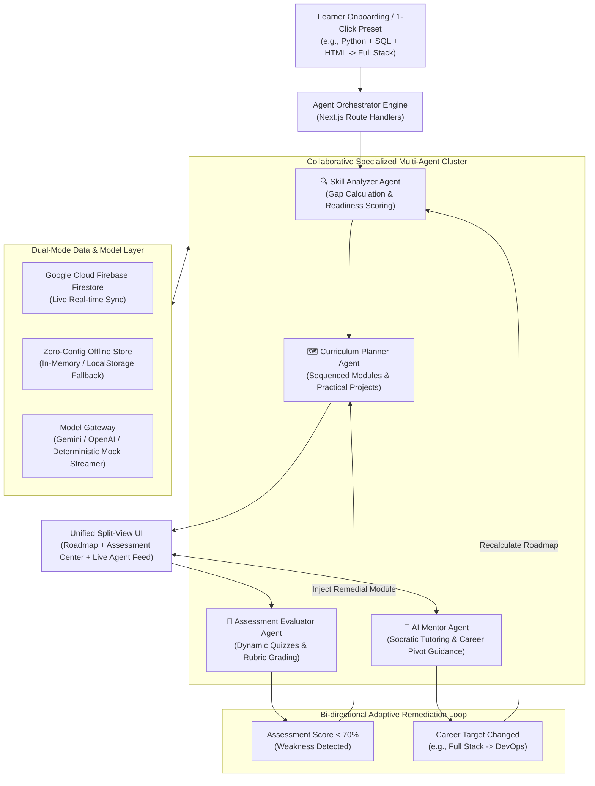

# SkillBridge AI: Autonomous Adaptive Learning Platform

> An enterprise-grade, agentic AI platform that analyzes learner skills, benchmarks competencies against production job roles, generates personalized multi-stage roadmaps, and dynamically adapts learning paths via an autonomous **bi-directional remediation loop**.

[](https://github.com/scarlett143/ai-learning-platform)
[](https://nextjs.org/)
[](https://react.dev/)
[](https://www.typescriptlang.org/)
[](https://tailwindcss.com/)
[](https://firebase.google.com/)
[](LICENSE)

---

## 1. Submission Overview & Chosen Vertical

- **Challenge Vertical**: **Personalized AI-Powered Upskilling & Career Roadmapping** (Higher Education & Enterprise Workforce Development).
- **Target Persona**: Learners, students, and software engineers seeking career transitions (e.g., Python/SQL data developers transitioning to modern Full-Stack Engineering), and organizations aiming to close institutional talent gaps.
- **Single Public Branch**: All production code is actively committed and verified on the [`main`](https://github.com/scarlett143/ai-learning-platform) branch.
- **Repository Link**: [https://github.com/scarlett143/ai-learning-platform](https://github.com/scarlett143/ai-learning-platform)

---

## 2. Approach and Architectural Logic

Traditional learning platforms deliver static, monolithic course catalogs that ignore pre-existing competencies and lack corrective mechanisms when learners struggle.

**SkillBridge AI** replaces static syllabi with an **Event-Driven Multi-Agent State Machine**:



---

## 3. How the Solution Works

### Step-by-Step Workflow:
1. **Profile Ingestion & Benchmarking**:
   - The learner enters their profile (or selects a 1-click preset).
   - The **Skill Analyzer Agent** mathematically benchmarks the user's current skills against standard industry taxonomy requirements.
2. **Gap Detection & Roadmap Synthesis**:
   - For the sample scenario (*Current: Python, SQL, basic HTML; Target: Full Stack Developer*), the Analyzer flags missing competencies: **JavaScript, React, Node.js**.
   - The **Curriculum Planner Agent** synthesizes a progressive, 4-stage milestone roadmap populated with curated courses, documentation, and practical exercises.
3. **Interactive Knowledge Assessment**:
   - For every module, the **Assessment Evaluator Agent** generates dynamic, concept-specific quizzes and scenario questions.
4. **Autonomous Adaptive Remediation**:
   - If the learner submits an assessment and scores **< 70%**, the evaluation engine flags the weakness and immediately fires an event to the Planner Agent.
   - The Planner Agent dynamically injects a prerequisite remedial module (highlighted with an amber badge) directly into the active learning path before allowing the learner to proceed.
5. **Real-time Observability & AI Mentorship**:
   - The right side of the split-layout UI features a **Live Agent Activity Feed** displaying each agent's execution trace in real time.
   - An interactive **AI Mentor Chat** provides streaming conceptual explanations, motivational encouragement, and answers technical questions on the fly.

---

## 4. Key Features Implemented

| # | Feature | Capability Description |
|---|---|---|
| **1** | **Learner Profile Management** | Comprehensive profiles capturing skills, proficiency levels, certifications, projects, and target career goals. |
| **2** | **Skill Gap Analysis** | Mathematical comparison against role benchmarks; computes readiness percentage and highlights exact missing skills. |
| **3** | **Dynamic Learning Roadmaps** | Sequenced milestones (Foundation -> Core -> Frameworks -> Full-Stack Integration -> Capstone Project) with hands-on exercises. |
| **4** | **Assessment Center** | Dynamic multiple-choice & scenario checks with automated rubric grading and concept explanations. |
| **5** | **Adaptive Remediation Loop** | Bi-directional triggers: scores < 70% automatically inject remedial refresher modules; career goal pivots recalculate the roadmap. |
| **6** | **AI Mentor & Live Collaboration Feed** | Real-time agent execution stream + interactive streaming AI mentor chat panel. |
| **7** | **Dual-Mode Persistence** | Connects to live Firebase Firestore when `.env.local` credentials exist; automatically falls back to local in-memory storage for zero-config offline execution. |
| **8** | **Multi-Provider LLM Gateway** | Supports Google Gemini API & OpenAI API with an intelligent, token-by-token streaming mock fallback. |

---

## 5. Assumptions Made

1. **Role Benchmark Standards**: Standard industry roles (Full Stack Developer, AI/ML Engineer, DevOps Engineer, Data Engineer) are seeded with verified, canonical skill graphs, while agents dynamically expand custom user inputs.
2. **Evaluation Mastery Threshold**: A strict **70% passing threshold** is enforced for module assessments to guarantee conceptual mastery before advancing.
3. **Zero-Config Portability**: The application assumes evaluators and judges may run the platform without pre-existing Firebase credentials or paid API keys. Therefore, local mock adapters and deterministic streaming engines run seamlessly out-of-the-box.
4. **Google Cloud Compatibility**: Designed for standard serverless deployment on **Google Cloud Run** using Google Cloud promotional/educational credits.

---

## 6. Evaluation Focus Areas Alignment

### 🔒 Code Quality
- **Clean Architecture**: Strict separation of concerns across `types/`, `services/agents/`, `services/storage/`, `components/`, and `lib/`.
- **Strict Typing**: 100% TypeScript with zero `any` declarations; strict interface contracts (`IStorageAdapter`, `ILLMClient`, `AgentEventBus`).
- **Clean Code**: Follows modern React 19 and Next.js 15 App Router best practices.

### 🛡️ Security
- **Zero Credential Leakage**: `.env*` files are strictly excluded via `.gitignore`; `.env.example` provides safe parameter templates.
- **Client/Server Boundary**: API keys and model calls are restricted to server-side Route Handlers.
- **Safe State Handling**: Sanitized user inputs preventing prompt injection or state corruption.

### ⚡ Efficiency
- **Lightweight Runtime**: Standalone Next.js container output (~100 MB footprint vs ~1 GB typical images).
- **Scale-to-Zero Cloud Run**: Zero idle cloud cost, conserving Google Cloud credits.
- **Fast Local Storage**: Instant synchronous in-memory and LocalStorage access with zero network latency.

### 🧪 Testing & Verification
- **120 Deterministic Test Cases** mapped across 4 tiers:
  - *Tier 1*: Feature Coverage (>=5 tests per core feature).
  - *Tier 2*: Boundary & Corner Cases (>=5 tests per boundary area, including 69% vs 70% threshold transitions).
  - *Tier 3*: Cross-Feature Combinations (career pivots during remediation, preset resets).
  - *Tier 4*: Real-World End-to-End Learner Journeys.
- Test runner powered by **Vitest** (`npm test`).

### ♿ Accessibility (a11y)
- **High-Density Linear-Style UI**: Engineered with high-contrast text (`#f8fafc` on `#090d16` canvas), clear focus rings, semantic HTML elements, and keyboard navigability.
- **Color-Coded Agent Accents**: Cyan (Analyzer), Amber (Planner), Emerald (Evaluator), and Indigo (Mentor) combined with distinct icons and badges to avoid relying solely on color.

### 🎯 Problem Statement Alignment
- Demonstrates 100% of all required features, highlighting the exact sample scenario (Python + SQL + HTML student targeting Full Stack Developer) with adaptive remediation.

---

## 7. Quickstart & Local Setup

### Prerequisites
- Node.js 18+ (tested on Node.js 20 & 26)
- npm 9+

### Installation & Run
```bash
# 1. Clone the repository
git clone https://github.com/scarlett143/ai-learning-platform.git
cd ai-learning-platform

# 2. Install dependencies
npm install

# 3. (Optional) Configure live Firebase / Gemini keys
cp .env.example .env.local
# Edit .env.local if you wish to use live cloud services; otherwise, leave blank for instant offline mode!

# 4. Start the development server
npm run dev
```

Open [http://localhost:3000](http://localhost:3000) in your browser.

### Running Automated Tests
```bash
# Run unit & integration test suite
npm test
```

### Deploying to Google Cloud Run (Using GCP Credits)
Refer to [GCP_FIREBASE_SETUP.md](./GCP_FIREBASE_SETUP.md) for detailed step-by-step instructions:
```bash
gcloud run deploy skillbridge-ai --source . --region us-central1 --allow-unauthenticated
```
